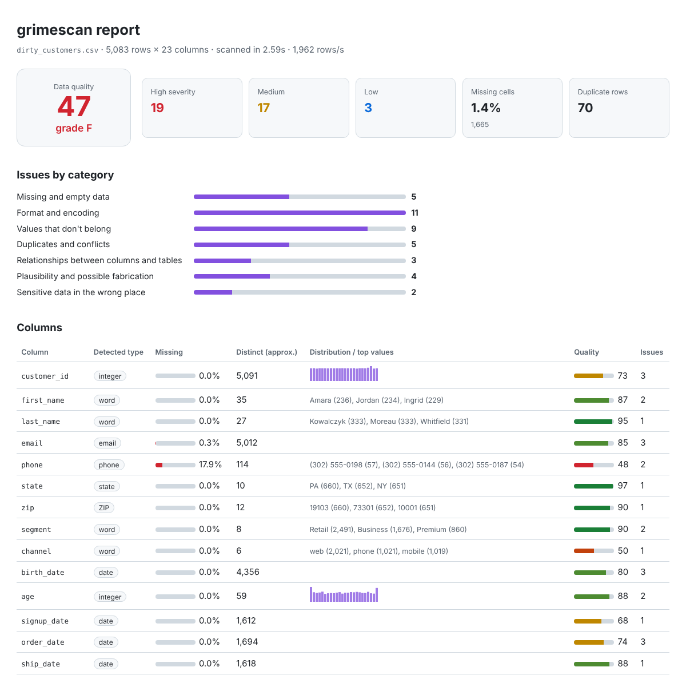

<div align="center">

# 🧽 grimescan

**Find the grime in huge datasets without writing a single rule.**

Missing and disguised nulls · duplicates and near-duplicates · wrong values · values that don't belong<br>
broken rows · impossible numbers · leaked SSNs, card numbers and API keys

[](https://github.com/vasukoduri/grimescan/actions/workflows/ci.yml)
[](https://pypi.org/project/grimescan/)
[](https://www.python.org/)
[](LICENSE)

```bash
pip install grimescan
grimescan scan customers.csv
```

</div>

---

Most data-quality tools ask you to write expectations first: *this column is never null, that one is between 0 and 100*. That works for tables you already understand. It doesn't help with the 40-column export someone dropped in a bucket, the vendor file nobody documented, or the 200-million-row table that has "always been fine".

**grimescan reads the data first and works out what each column is supposed to be.** It recognizes emails, dates, ZIP codes, phone numbers, amounts, names, IDs and more, then reports everything that doesn't fit. It also checks how columns relate to each other (does `total` really equal `subtotal + tax − discount`?) and how rows relate to each other (is this batch loaded twice? is this customer stored under two IDs?).

It runs as **two streaming passes with constant memory**, so the file never has to fit in RAM.

<div align="center">

<br><sub>The HTML report for the built-in demo dataset (<code>grimescan demo</code>)</sub>
</div>

## Contents

- [Quick start](#quick-start)
- [What it finds](#what-it-finds): 35 checks in 7 categories
- [Python API](#python-api)
- [Command line](#command-line)
- [Reports](#reports)
- [Use it as a quality gate in CI](#use-it-as-a-quality-gate-in-ci)
- [How it works](#how-it-works)
- [Performance](#performance)
- [Limits](#limits)

## Quick start

```bash
pip install grimescan                  # core: only needs numpy
pip install "grimescan[parquet]"       # + Parquet via pyarrow
pip install "grimescan[all]"           # + pandas, polars and Parquet
```

See it work on a dataset with 25 kinds of planted problems:

```bash
grimescan demo
```

```
grimescan 0.1.0  dirty_customers.csv  (5,083 rows × 23 columns, 2.7s)
  quality score 47.0/100  grade F
  issues: 19 high, 17 medium, 3 low   missing cells 1.4%   duplicate rows 70
  ✖ high         70  Exact duplicate rows
  ✖ high         50  A batch of rows was loaded twice
  ✖ high         31  total doesn't add up
  ✖ high         25  ship_date before order_date
  ✖ high         18  Conflicting records for the same customer_id
  ✖ high         11  Lost leading zeros in zip
  ✖ high         10  Numbers in scientific notation in customer_id
  ...
  planted problems detected: 25/25
```

Then point it at your own data:

```bash
grimescan scan orders.csv                  # CSV, TSV, JSON Lines or Parquet
grimescan scan big.parquet --max-rows 5000000 --out reports/orders
```

## What it finds

Every check is on by default. None of them needs configuration.

### 🕳️ Missing and empty data

| Check | What it catches |
|---|---|
| `high_missing_rate` | Columns that are almost empty, or have a high share of missing values |
| `whitespace_only` | Values that look filled in but are only spaces, tabs or other blank characters |
| `disguised_nulls` | `N/A`, `null`, `unknown`, `-`, numeric sentinels like `-1` or `9999`, dates like `1900-01-01` |
| `mostly_empty_rows` | Rows where at least half the fields are missing in an otherwise well-filled dataset |
| `missing_together` | Columns that go missing in the same rows: usually one broken join, source or form section |
| `missing_by_group` | A column missing far more often for one category (*phone is missing for 89% of `store` orders*) |
| `default_value_inflation` | One value filling a large share of a varied column, such as the load date written where the real date was missing |

### 🔤 Format and encoding

| Check | What it catches |
|---|---|
| `date_problems` | Mixed formats in one column, conflicting day/month order, February 30, future birth dates, dates before 1900 |
| `spreadsheet_damage` | IDs mangled into scientific notation (`1.23457E+15`) and ZIP codes that lost their leading zero (`07030` → `7030`) |
| `numbers_as_text` | `$1,200.50`, `(500)`, `12%`, `5 kg` in numeric columns |
| `encoding_and_characters` | Mojibake (`José` → suggests `José`), zero-width and non-breaking spaces, control characters, untrimmed values |
| `truncated_values` | Many values cut off at exactly the same length, often a field limit like 50 or 255 |
| `inconsistent_categories` | `Retail` / `retail ` / `RETAIL`, typos of a common value (`Retial`), yes/no columns written several ways |

### 🧩 Values that don't belong

| Check | What it catches |
|---|---|
| `type_mismatch` | An email in the phone column, a word in an amount column, a date in a name column, with a plain description of each |
| `swapped_columns` | Latitude and longitude reversed; two columns' values swapped in the same row |
| `broken_rows` | Rows with the wrong number of fields (an unquoted comma), and rows whose values shifted one column over |
| `header_and_summary_rows` | The header repeated mid-file (concatenated exports) and `TOTAL` rows exported with the records |
| `placeholder_values` | `test`, `asdf`, `lorem ipsum`, `John Doe`, `test@test.com`, `555-555-5555`, `xxxx` |
| `markup_and_code` | HTML, SQL, stack traces, unrendered `{{templates}}`, `[object Object]`, JSON blobs |
| `unexpected_script` | Cyrillic, Chinese or Arabic values in an otherwise Latin-only column |

### 👯 Duplicates and conflicts

| Check | What it catches |
|---|---|
| `duplicates` | Exact duplicate rows, duplicates once case and spacing are ignored, **whole batches loaded twice**, duplicate keys, and **records with the same key but different values** |
| `near_duplicates` | The same entity with small differences (`Jon Smith, 12 Oak St` vs `John Smith, 12 Oak Street`), including under different IDs. Uses MinHash with locality-sensitive hashing, so it never compares every pair |

### 🔗 Relationships between columns and tables

| Check | What it catches |
|---|---|
| `date_order` | End before start, shipped before ordered, updated before created, died before born |
| `total_mismatch` | **Discovers the formula** from the data (e.g. `total = subtotal + tax − discount`), then reports every row where it doesn't hold |
| `age_vs_birth_date` | Ages that disagree with the date of birth, after learning the dataset's snapshot offset |
| `check_foreign_key()` | Child rows pointing at parent keys that don't exist (orphans) |

### 🎲 Plausibility and possible fabrication

| Check | What it catches |
|---|---|
| `impossible_values` | Negative ages, quantities and prices; ages over 120; percentages over 100; coordinates off the globe; *Null Island* (0, 0) |
| `outliers` | Values extremely far from the rest (robust z-score on median and MAD, so outliers can't hide each other) |
| `unit_mixup` | Two clusters ~100× or ~1,000× apart: cents mixed with dollars, grams with kilograms |
| `round_number_heaping` | Far too many exact multiples of 100 or 1,000: estimates, defaults or invented figures |
| `benford` | Leading digits that deviate from Benford's law, a classic screen for made-up amounts |
| `time_stripped` | Timestamps where nearly every time is `00:00:00` |
| `constant_column` | Columns where every value is the same |

### 🔐 Sensitive data in the wrong place

| Check | What it catches |
|---|---|
| `pii_in_free_text` | SSNs, card numbers and IBANs typed into notes and comments, where masking and access controls don't reach |
| `secrets` | AWS keys, GitHub/Stripe/Slack tokens, private keys, passwords in connection strings |
| `unmasked_card_numbers` | Luhn-valid card numbers with a real network prefix stored in clear (PCI DSS) |

**Sensitive values are never written to a report in clear.** SSN- and card-shaped values are masked everywhere (`•••-••-6789`), whichever check found them.

## Python API

```python
import grimescan

report = grimescan.scan("customers.csv")         # a path, a pandas/polars DataFrame, or a list of dicts

print(report.score, report.grade)                  # 47.0 F
for issue in report.issues:
    print(issue.severity, issue.title, issue.count)
    for ex in issue.examples:
        print("   row", ex.row, ex.column, repr(ex.value), "->", ex.note, ex.suggestion or "")

report.save("reports/customers")                   # report.html, report.json, report.md, fix_list.csv
```

It works the same on DataFrames:

```python
import pandas as pd
report = grimescan.scan(pd.read_parquet("orders.parquet"), key_columns=["order_id"])
```

Options (all optional):

| Option | Default | Meaning |
|---|---|---|
| `include` / `exclude` | all | Check ids or categories to run or skip, e.g. `include=["duplicates", "sensitive"]` |
| `key_columns` | detected | The ID column(s); otherwise found from names like `id`, `*_id`, `*_key` and uniqueness |
| `max_rows` | all | Stop after this many rows |
| `sample_size` | 5,000 | Values per column kept in the reservoir sample used to learn types and distributions |
| `near_duplicate_limit` | 20,000 | Rows indexed for near-duplicate search |
| `max_examples` | 10 | Examples kept per issue |
| `type_threshold` | 0.8 | Share of values that must fit a type for the column to get that type |
| `reference_date` | today | "Now", for future-date and age checks on historical snapshots |

Check foreign keys across two tables:

```python
issue = grimescan.check_foreign_key("orders.csv", "customer_id", "customers.csv", "id")
```

## Command line

```bash
grimescan scan PATH [PATH ...]      # scan one or more files
    --out DIR                       # where to write the reports (default: grimescan-report;
                                    #   one sub-folder per file when scanning several)
    --only CHECKS / --skip CHECKS   # comma-separated check ids or categories
    --key COLUMN                    # the ID column
    --max-rows N --sample-size N --delimiter ';'
    --fail-under SCORE              # exit 1 if the quality score is below SCORE
    --fail-on high|medium|low       # exit 1 if any issue has this severity or worse
    --json                          # print the JSON report to stdout
grimescan fk orders.csv:customer_id customers.csv:id
grimescan checks                    # list every check
grimescan demo                      # generate a dirty dataset and scan it
```

## Reports

Each scan writes four files:

| File | For |
|---|---|
| `report.html` | People. One self-contained page: score, issues by category, a profile of every column with distributions and top values, a heatmap of where values go missing across the file, and every issue with example rows |
| `report.json` | Pipelines. Every issue with its check id, severity, columns, count, rate and examples |
| `report.md` | Pull requests, tickets and wikis |
| `fix_list.csv` | Fixing. One row per example: row number, column, value, problem, suggested fix |

The score starts each column at 100 and takes a share off for every issue, weighted by severity (high 1.0, medium 0.5, low 0.2) and by how much of the column it affects. The dataset score is the average column score, reduced again for dataset-wide problems like duplicate rows. Grades: **A** ≥ 90, **B** ≥ 80, **C** ≥ 65, **D** ≥ 50, **F** below.

## Use it as a quality gate in CI

```yaml
- run: pip install grimescan
- run: grimescan scan data/extract.csv --fail-on high --fail-under 80
- uses: actions/upload-artifact@v4
  if: always()
  with: { name: data-quality, path: grimescan-report }
```

Or in a pipeline:

```python
ok, reasons = grimescan.scan(df).check(fail_under=80, fail_on="high")
if not ok:
    raise ValueError("data quality gate failed: " + "; ".join(reasons))
```

## How it works

```
             pass 1: profile                           pass 2: check                      pass 3: examples
 rows ──▶  per column: HyperLogLog distinct   ──▶  every check sees each value   ──▶  re-read only the
           counts, reservoir sample, top-k         (and, if it needs, each row),       rows quoted in the
           heavy hitters, length and missing       using what pass 1 learned:          report, to show
           timelines, running stats                types, ranges, formulas, keys       them in full
                        │
                        ▼
           infer each column's semantic type,
           discover total formulas, keys,
           date pairs, groups, clusters
```

- **No rules needed.** Pass 1 learns what *normal* looks like for each column, from a uniform sample (Algorithm L reservoir) plus exact streaming counts. Pass 2 flags what doesn't fit.
- **Constant memory.** Sketches have fixed size: HyperLogLog (±2% distinct counts), Space-Saving top-k, Bloom filters, Welford statistics. Duplicate detection keeps a few 64-bit hashes per row (at most 32 bytes) in compact arrays and groups them with numpy.
- **Near-duplicates without O(n²).** Rows are shingled and MinHashed; locality-sensitive hashing proposes candidate pairs, numpy verifies them, and pairs must also agree field by field.
- **Less noise.** Structural rows (repeated headers, broken rows, `TOTAL` lines) are reported once and kept out of the per-column checks. When two checks explain the same values, the more specific one wins (a ×1,000 cluster is a unit mix-up, not 255 outliers).

More detail in [docs/architecture.md](docs/architecture.md).

## Performance

On a 2-core cloud VM, Python 3.13, all 35 checks enabled:

| Dataset | Rows × columns | Time | Throughput |
|---|---|---|---|
| Demo customers (dirty) | 5,083 × 23 | 2.7 s | |
| Demo customers (dirty) | 50,083 × 23 | 15 s | ~3,300 rows/s · ~76,000 values/s |

Memory stays flat as files grow: the sketches have fixed size and duplicate detection costs at most 32 bytes per row (about 320 MB for 10 million rows). For very large tables, `--max-rows`, `--only` (the duplicate checks are the most expensive) and scanning partitions in parallel all help.

## Limits

grimescan is a fast first look, not a contract.

- It **learns from the data**, so a problem affecting most of a column becomes "normal". If every date is wrong in the same way, it won't notice. Pair it with explicit expectations for tables you understand well.
- Type inference covers common US/EU formats. It doesn't yet know every national ID, phone or address format.
- Near-duplicate search is limited to the first 20,000 rows by default (`near_duplicate_limit`).
- Statistical checks (outliers, Benford, round numbers, unit mix-ups) need enough values to be meaningful and stay silent on small columns.
- Findings are leads to review, not verdicts. A "near duplicate" may be twins; a Benford deviation may be a pricing policy.

## Contributing

New checks, file formats and type recognizers are welcome. See [CONTRIBUTING.md](CONTRIBUTING.md). Please report security issues privately, as described in [SECURITY.md](SECURITY.md).

## License

[Apache 2.0](LICENSE) © Vasu Koduri
